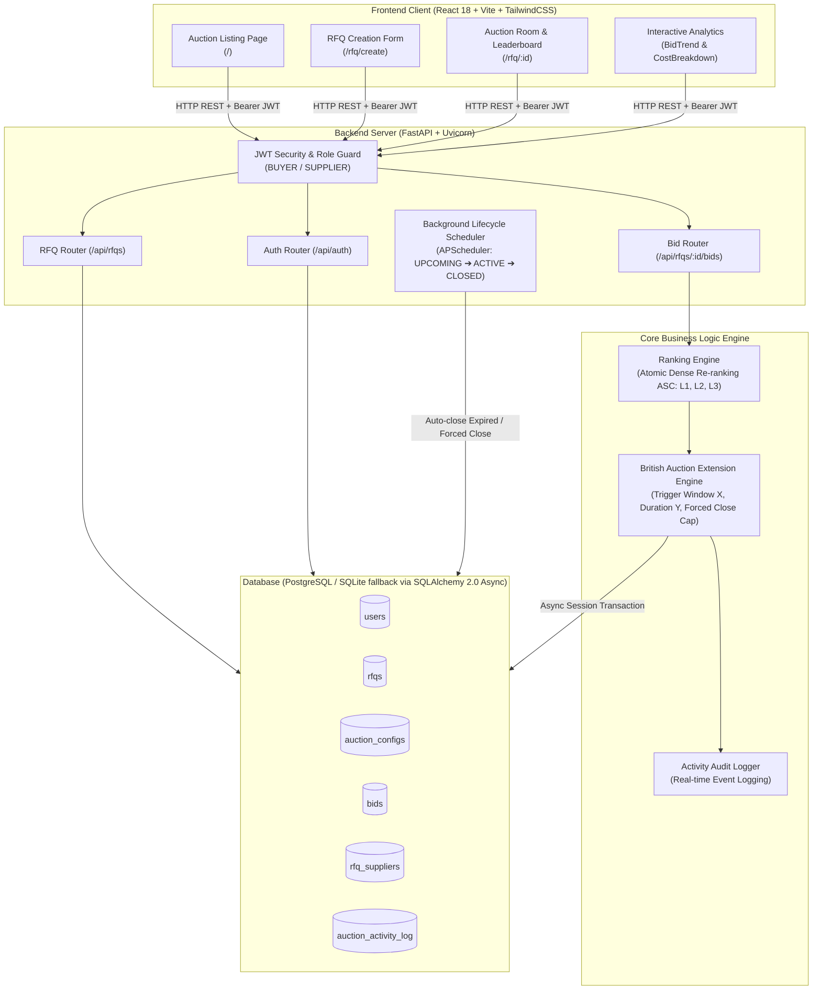
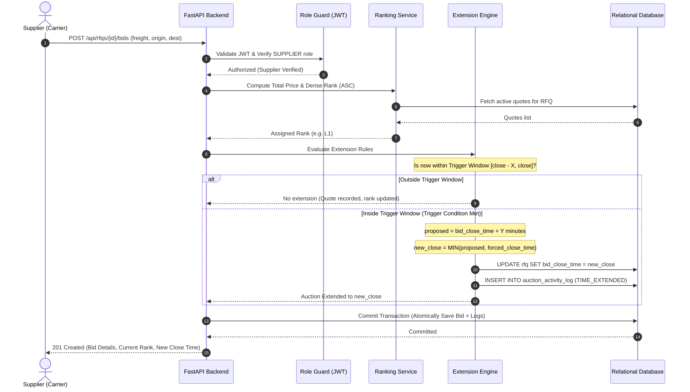

# High-Level Design (HLD): British Auction RFQ System

## 1. Problem & Executive Summary
In logistics freight procurement, buyers issue **Requests for Quotation (RFQs)** inviting transport carriers to quote. In conventional sealed-bid procurement, **bid sniping** (submitting bids in the final seconds) deprives genuine carriers of the opportunity to respond and prevents fair market price discovery.

The **British Auction mechanism** in this system provides:
* **Dynamic Auto-Extension**: If competitive bids arrive during the **Trigger Window ($X$ minutes)** before close, the auction extends by **$Y$ minutes**.
* **Hard Cutoff Cap**: Extensions can **never exceed the Forced Close deadline**, preventing indefinite delays.
* **Transparent Reverse Bidding**: Real-time rank leaderboard ($L_1, L_2, L_3\dots$) where the lowest price wins.

---

## 2. System Architecture Diagram

---

## 3. Core Component Breakdown

| Layer / Component | Technology | Primary Responsibilities |
| :--- | :--- | :--- |
| **Frontend SPA** | React 18, Vite, Tailwind CSS | Buyer RFQ creation, carrier quoting modal, live L1/L2 leaderboard, countdown timers, price trend charts. |
| **API Gateway & Auth** | FastAPI, Python-Jose (JWT) | Role-Based Access Control (`BUYER` vs `SUPPLIER`), schema validation, CORS security. |
| **Extension Engine** | Python 3.12, SQLAlchemy Async | Atomic evaluation of trigger conditions ($X$), duration ($+Y$), and forced close cap enforcement. |
| **Ranking Service** | Python 3.12 | Computes lowest total price ($L_1$), handles ties by earliest submission timestamp. |
| **Lifecycle Scheduler** | APScheduler | Evaluates auction deadlines every 15 seconds, transitions `UPCOMING` $\rightarrow$ `ACTIVE` $\rightarrow$ `CLOSED`. |
| **Data Persistence** | PostgreSQL 14+ / SQLite fallback | ACID transactions, foreign key cascades, check constraints, indexed lookup by status and close time. |

---

## 4. British Auction Sequence Diagram

---

## 5. Anti-Sniping Guarantees & Edge Cases

1. **Anti-Sniping Protection**:
   - Submissions inside the final **X minutes** automatically extend the clock by **Y minutes**, allowing all participants time to re-evaluate their quotes.
2. **Hard Deadline Cap**:
   - `bid_close_time = min(proposed_time, forced_close_time)`
   - If an extension would push the close time beyond the hard cap, it is clipped exactly to `forced_close_time`.
3. **Database Concurrency**:
   - Bid submission, re-ranking, and extension evaluation run within a single database transaction, preventing race conditions.

