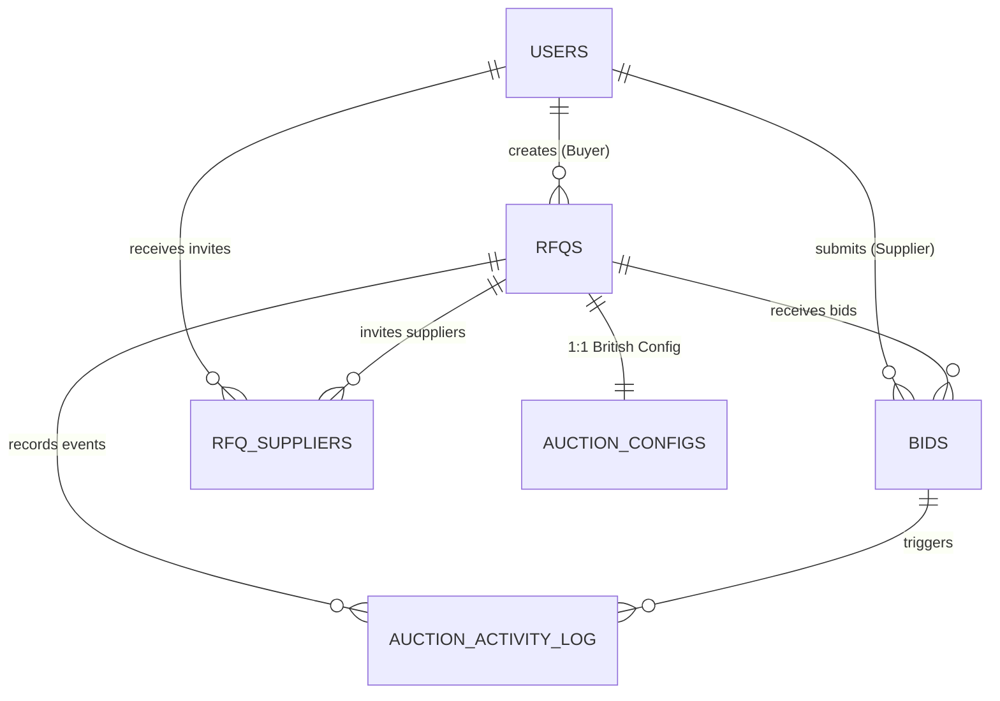

# GoComet — British Auction RFQ System

> Production-grade implementation of a **Reverse Logistics RFQ System with British Auction Anti-Sniping Bidding Mechanics**, built to full specification of the GoComet technical assignment.

---

## 📌 Table of Contents
1. [Overview & Core Value](#-overview--core-value)
2. [British Auction Extension Engine Logic](#-british-auction-extension-engine-logic)
3. [Interactive Visual Analytics & Graphs](#-interactive-visual-analytics--graphs)
4. [Tech Stack](#-tech-stack)
5. [Database Architecture & Schema](#-database-architecture--schema)
6. [Quick Start (One-Click Launch)](#-quick-start-one-click-launch)
7. [Manual Setup & Migration Guide](#-manual-setup--migration-guide)
8. [Automated Test Suite (18/18 Passing)](#-automated-test-suite-1818-passing)
9. [Pre-Seeded Demo Credentials](#-pre-seeded-demo-credentials)
10. [API Documentation & Example Requests](#-api-documentation--example-requests)
11. [Deliverables Checklist](#-deliverables-checklist)

---

## 🌟 Overview & Core Value

In freight procurement, buyers issue **Requests for Quotation (RFQs)** inviting logistics carriers to quote. In traditional procurement, **bid sniping** (submitting bids at the very last second) gives unfair advantages to automated bots while depriving genuine carriers of the opportunity to counter.

This project implements the **British Auction Reverse Bidding Model**:
* **Open Competition**: Real-time broadcast of all quotes and leaderboard rankings ($L_1, L_2, L_3\dots$).
* **Reverse Bidding**: Carriers continuously lower their quotes to become the lowest price ($L_1$) leader.
* **Intelligent Auto-Extension**: If bidding activity occurs during the **Trigger Window ($X$ minutes)** before close, the closing time is dynamically extended by **$Y$ minutes**.
* **Hard Cutoff Cap**: Extensions can **never exceed the Forced Close deadline**, guaranteeing timely auction finalization.

---

## ⚡ British Auction Extension Engine Logic

When a supplier submits a competitive quote, the extension engine runs atomically inside the database transaction:

```
                  ┌───────────────────────────────┐
                  │ Carrier Submits a Quote / Bid │
                  └──────────────┬────────────────┘
                                 │
                   Is now within Trigger Window?
               [now >= bid_close_time - X minutes]
                                 │
                 ┌───────────────┴───────────────┐
                 │ YES                           │ NO
                 ▼                               ▼
     Does it satisfy Trigger Type?         NO EXTENSION
      - BID_RECEIVED                       (Quote recorded,
      - ANY_RANK_CHANGE                     rank recomputed)
      - L1_RANK_CHANGE
                 │
                 ▼
     Calculate Extended Deadline:
  proposed = bid_close_time + Y minutes
                 │
                 ▼
     Enforce Forced Close Hard Cap:
  new_close = MIN(proposed, forced_close_time)
                 │
                 ▼
     Write Audit Activity Log & Broadcast
```

---

## 📊 Interactive Visual Analytics & Graphs

The platform includes **three built-in data visualizations** on every auction room:

1. **Reverse Auction Price Reduction Trend (`BidTrendChart.jsx`)**:
   - An SVG line and gradient-fill area chart plotting the price drop trajectory over time as carriers underbid each other.
   - Highlights the initial baseline quote, the lowest price ($L_1$) leader, total cost savings in INR, and overall discount percentage.
2. **Quote Cost Component Breakdown (`CostBreakdownChart.jsx`)**:
   - Stacked horizontal bar graphs showing the exact component breakdown for every competing carrier: **Ocean Freight** (Blue), **Origin Charges** (Amber), and **Destination Charges** (Violet).
3. **British Auction Timeline & Extension Horizon (`AuctionTimeline.jsx`)**:
   - Visual progress bar showing elapsed bidding time, the live trigger window zone ($X$ mins), rolling close time markers, and the hard forced-close ceiling.
4. **Executive KPI Dashboard Cards (`AuctionList.jsx`)**:
   - Real-time counters for **Total RFQs**, **Active Live Auctions** (with pulsing heartbeat indicator), **Total Quotes Received**, and **Awarded Contracts**.

---

## 🛠️ Tech Stack

### Backend
* **Python 3.12** with **FastAPI** (High performance, async native, auto OpenAPI/Swagger docs).
* **SQLAlchemy 2.0 (Async)** with `asyncpg` and automatic **local SQLite fallback** (`sqlite+aiosqlite`).
* **Pydantic v2** for bidirectional validation and schema serialization.
* **Passlib / Direct Bcrypt** for secure password hashing.
* **Python-Jose** for JWT token issuance and role-based access verification (`BUYER` vs `SUPPLIER`).
* **APScheduler** background daemon evaluating auction expiration and deadlines every 15 seconds.
* **Pytest + Pytest-Asyncio + HTTPX** for comprehensive automated testing.

### Frontend
* **React 18** + **Vite 5**.
* **Tailwind CSS v3** with custom typography, responsive grids, and micro-interactions.
* **Axios** with automatic snake_case $\leftrightarrow$ camelCase bi-directional mapping.
* **React Hot Toast** for notifications.
* **Date-fns** for time calculations and countdowns.
* **React ErrorBoundary** for zero-white-screen resilience.

---

## 🗄️ Database Architecture & Schema

The relational schema strictly enforces all business rules:



### Table Definitions:
* **`users`**: Stores Buyer and Supplier accounts with hashed passwords and roles.
* **`rfqs`**: Core freight requests (`name`, `reference_id`, `bid_start_time`, `bid_close_time`, `forced_close_time`, `pickup_service_date`, `status`, `awarded_bid_id`).
  - *Constraints*: `forced_close_time > bid_close_time` and `bid_close_time > bid_start_time`.
* **`auction_configs`**: Stores $X$ (Trigger window), $Y$ (Extension duration), and `trigger_type` (`BID_RECEIVED`, `ANY_RANK_CHANGE`, `L1_RANK_CHANGE`).
* **`bids`**: Stores supplier quotes with individual charges: `freight_charges`, `origin_charges`, `destination_charges`, auto-computed `total_charges`, `transit_time`, `quote_validity`, `rank`, and `is_active`.
* **`auction_activity_log`**: Append-only audit trail logging all events (`RFQ_CREATED`, `BID_SUBMITTED`, `TIME_EXTENDED`, `AUCTION_CLOSED`, `QUOTE_AWARDED`) with before/after timestamps and reasons.

---

## 🚀 Quick Start (One-Click Launch)

On Windows, use the pre-configured batch scripts in the `scripts/` folder:

### 1. Launch All Services Together
Double-click:
```cmd
scripts\run_all.bat
```
*(Starts the FastAPI backend on `http://localhost:5000` and the React frontend on `http://localhost:5173` in separate windows)*

### 2. Launch Separately
* **Backend**: `scripts\run_backend.bat` $\rightarrow$ Docs at [http://localhost:5000/docs](http://localhost:5000/docs)
* **Frontend**: `scripts\run_frontend.bat` $\rightarrow$ App at [http://localhost:5173](http://localhost:5173)
* **Run Tests**: `scripts\test_backend.bat` $\rightarrow$ Runs 18 automated unit and integration tests

---

## 💻 Manual Setup & Migration Guide

### 1. Backend Setup
```bash
cd backend

# Create & activate virtual environment
python -m venv venv
.\venv\Scripts\activate      # Windows
# source venv/bin/activate   # macOS / Linux

# Install dependencies
pip install -r requirements.txt

# Run migrations & seed data
python -m app.utils.seed

# Start FastAPI server
uvicorn app.main:app --reload --port 5000
```

> **Zero Setup Database Notice**: By default, the application connects to PostgreSQL. If PostgreSQL is not installed or authentication fails, the backend automatically falls back to an embedded SQLite database (`backend/rfq_auction.db`). Everything works out of the box!

### 2. Frontend Setup
```bash
cd frontend
npm install
npm run dev
```

---

## 🧪 Automated Test Suite (18/18 Passing)

To run the comprehensive test suite:
```bash
.\backend\venv\Scripts\pytest backend\tests -v
```

### Coverage Highlights:
- **`test_auction_engine.py`**:
  - `test_extension_triggers_when_in_window_and_l1_changes` — Verified.
  - `test_extension_capped_at_forced_close_time` — Verified.
  - `test_no_extension_outside_trigger_window` — Verified.
- **`test_extension_engine_comprehensive.py`**:
  - `test_extension_outside_trigger_window_does_not_extend` — Verified.
  - `test_extension_trigger_bid_received_always_extends` — Verified.
  - `test_extension_trigger_any_rank_change` — Verified.
  - `test_extension_trigger_l1_rank_change` — Verified.
  - `test_extension_never_exceeds_forced_close_time` — Verified.
  - `test_extension_halts_when_already_at_forced_close` — Verified.
  - `test_activity_log_written_with_correct_metadata` — Verified.
- **`test_rfq_validation.py`**:
  - `forced_close_time <= bid_close_time` rejection — Verified.
  - `bid_close_time <= bid_start_time` rejection — Verified.
  - Missing British Auction config rejection — Verified.
  - Valid British Auction creation — Verified.
- **`test_role_access.py`**:
  - Unauthenticated access rejection (401) — Verified.
  - Supplier forbidden from creating RFQs (403) — Verified.
  - Buyer forbidden from submitting bids (403) — Verified.
  - Supplier forbidden from awarding quotes (403) — Verified.

---

## 🔑 Pre-Seeded Demo Credentials

| Role | Email | Password | Features Accessible |
|---|---|---|---|
| **Buyer** | `buyer@gocomet.com` | `password123` | Create RFQs, configure British parameters ($X, Y$), view bids, award contracts |
| **Supplier 1** | `supplier1@gocomet.com` | `password123` | FedEx Logistics — View invited RFQs, submit quotes, track ranks |
| **Supplier 2** | `supplier2@gocomet.com` | `password123` | DHL Express — Compete for $L_1$ rank, trigger auto-extensions |
| **Supplier 3** | `supplier3@gocomet.com` | `password123` | Blue Dart Cargo — Additional carrier competitor |

---

## 📡 API Documentation & Example Requests

FastAPI automatically generates interactive Swagger documentation available at:
**[http://localhost:5000/docs](http://localhost:5000/docs)**

### Example: Create a British Auction RFQ (Buyer)
```bash
curl -X POST "http://localhost:5000/api/rfqs" \
  -H "Authorization: Bearer <BUYER_TOKEN>" \
  -H "Content-Type: application/json" \
  -d '{
    "name": "Ocean Freight 40ft HC - Shanghai to Rotterdam",
    "bid_start_time": "2026-10-31T08:00:00Z",
    "bid_close_time": "2026-10-31T18:00:00Z",
    "forced_close_time": "2026-10-31T20:00:00Z",
    "pickup_service_date": "2026-11-15",
    "is_british_auction": true,
    "supplier_ids": ["<SUPPLIER_UUID_1>", "<SUPPLIER_UUID_2>"],
    "auction_config": {
      "trigger_window_minutes": 10,
      "extension_duration_minutes": 5,
      "trigger_type": "L1_RANK_CHANGE"
    }
  }'
```

### Example: Submit a Competitive Quote (Supplier)
```bash
curl -X POST "http://localhost:5000/api/rfqs/<RFQ_ID>/bids" \
  -H "Authorization: Bearer <SUPPLIER_TOKEN>" \
  -H "Content-Type: application/json" \
  -d '{
    "carrier_name": "Maersk Line",
    "freight_charges": 35000.00,
    "origin_charges": 4000.00,
    "destination_charges": 3000.00,
    "transit_time": "18 Days",
    "quote_validity": "2026-11-30"
  }'
```

---

## ✅ Deliverables Checklist

- [x] **Deliverable 1: High-Level Design (HLD) with Architecture Diagram** $\rightarrow$ See [`DELIVERABLES.md`](./DELIVERABLES.md)
- [x] **Deliverable 2: Relational Database Schema Design** $\rightarrow$ See [`schema-design.md`](./schema-design.md)
- [x] **Deliverable 3: Pure Python Backend Code** $\rightarrow$ Fully contained in `backend/`
- [x] **Deliverable 4: Modern React Frontend Code** $\rightarrow$ Fully contained in `frontend/`
- [x] **Video Script & Project Presentation Guide** $\rightarrow$ See [`scripts/VIDEO_SCRIPT.md`](./scripts/VIDEO_SCRIPT.md) and [`scripts/PROJECT_EXPLANATION.md`](./scripts/PROJECT_EXPLANATION.md)
