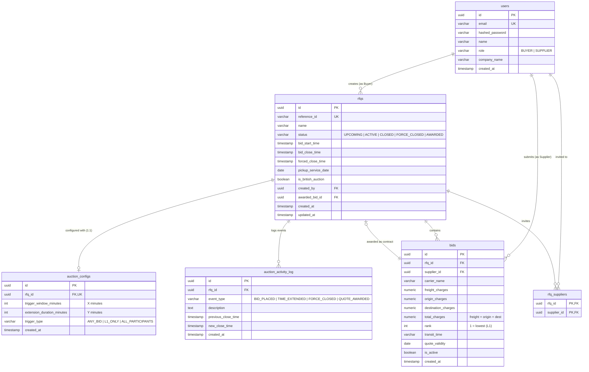

# Database Schema Design: British Auction RFQ System

## 1. Entity-Relationship (ER) Diagram

---

## 2. Table Specifications & Columns

### 2.1 Table: `users`
Stores user identities and roles for authentication and RBAC.

| Column | Type | Constraints | Description |
| :--- | :--- | :--- | :--- |
| `id` | `UUID` | `PRIMARY KEY` | Unique user identifier |
| `email` | `VARCHAR(255)` | `NOT NULL, UNIQUE` | Login email address |
| `hashed_password` | `VARCHAR(255)` | `NOT NULL` | Bcrypt hashed password |
| `name` | `VARCHAR(255)` | `NOT NULL` | Full name of user |
| `role` | `VARCHAR(50)` | `NOT NULL` | Enum: `'BUYER'` or `'SUPPLIER'` |
| `company_name` | `VARCHAR(255)` | `NULLABLE` | Associated logistics or manufacturing company |
| `created_at` | `TIMESTAMP WITH TZ` | `NOT NULL, DEFAULT NOW()` | Account creation timestamp |

---

### 2.2 Table: `rfqs`
Central entity for freight requests and British auction state.

| Column | Type | Constraints | Description |
| :--- | :--- | :--- | :--- |
| `id` | `UUID` | `PRIMARY KEY` | Unique RFQ identifier |
| `reference_id` | `VARCHAR(50)` | `NOT NULL, UNIQUE` | Human-readable identifier (e.g. `RFQ-202610-001`) |
| `name` | `VARCHAR(255)` | `NOT NULL` | Shipment title (e.g., Shanghai to Rotterdam 40ft HC) |
| `status` | `VARCHAR(50)` | `NOT NULL, DEFAULT 'UPCOMING'` | `'UPCOMING'`, `'ACTIVE'`, `'CLOSED'`, `'FORCE_CLOSED'`, `'AWARDED'` |
| `bid_start_time` | `TIMESTAMP WITH TZ` | `NOT NULL` | Bidding start timestamp |
| `bid_close_time` | `TIMESTAMP WITH TZ` | `NOT NULL` | Dynamic closing timestamp (extended by British engine) |
| `forced_close_time` | `TIMESTAMP WITH TZ` | `NOT NULL` | Immutable maximum hard cutoff deadline |
| `pickup_service_date`| `DATE` | `NOT NULL` | Expected cargo pickup date |
| `is_british_auction` | `BOOLEAN` | `NOT NULL, DEFAULT FALSE` | Flag enabling dynamic auto-extension engine |
| `created_by` | `UUID` | `NOT NULL, FK -> users(id)` | Buyer who issued the RFQ |
| `awarded_bid_id` | `UUID` | `NULLABLE, FK -> bids(id)` | Final accepted quote upon contract award |
| `created_at` | `TIMESTAMP WITH TZ` | `NOT NULL, DEFAULT NOW()` | RFQ creation timestamp |
| `updated_at` | `TIMESTAMP WITH TZ` | `NOT NULL, DEFAULT NOW()` | Last update timestamp |

**Check Constraints:**
- `CHECK (bid_close_time > bid_start_time)`
- `CHECK (forced_close_time > bid_close_time)`

---

### 2.3 Table: `auction_configs`
Stores British Auction extension rules for an RFQ (1:1 relationship).

| Column | Type | Constraints | Description |
| :--- | :--- | :--- | :--- |
| `id` | `UUID` | `PRIMARY KEY` | Unique configuration ID |
| `rfq_id` | `UUID` | `NOT NULL, UNIQUE, FK -> rfqs(id) ON DELETE CASCADE` | 1-to-1 link to parent RFQ |
| `trigger_window_minutes` | `INT` | `NOT NULL, CHECK (> 0)` | **Trigger Window ($X$)**: Minutes before close where bids trigger extension |
| `extension_duration_minutes`| `INT` | `NOT NULL, CHECK (> 0)` | **Extension Duration ($Y$)**: Minutes added to clock on trigger |
| `trigger_type` | `VARCHAR(50)` | `NOT NULL` | `'ANY_BID'`, `'L1_ONLY'`, or `'ALL_PARTICIPANTS'` |
| `created_at` | `TIMESTAMP WITH TZ` | `NOT NULL, DEFAULT NOW()` | Creation timestamp |

---

### 2.4 Table: `bids`
Stores quotes submitted by suppliers.

| Column | Type | Constraints | Description |
| :--- | :--- | :--- | :--- |
| `id` | `UUID` | `PRIMARY KEY` | Unique quote ID |
| `rfq_id` | `UUID` | `NOT NULL, FK -> rfqs(id) ON DELETE CASCADE` | Associated RFQ |
| `supplier_id` | `UUID` | `NOT NULL, FK -> users(id)` | Quoting supplier |
| `carrier_name` | `VARCHAR(255)` | `NOT NULL` | Shipping line / carrier (e.g., Maersk, MSC, CMA CGM) |
| `freight_charges` | `NUMERIC(12, 2)` | `NOT NULL, CHECK (>= 0)` | Ocean / Air base freight charge |
| `origin_charges` | `NUMERIC(12, 2)` | `NOT NULL, DEFAULT 0, CHECK (>= 0)` | Terminal origin port / handling fees |
| `destination_charges`| `NUMERIC(12, 2)` | `NOT NULL, DEFAULT 0, CHECK (>= 0)` | Destination discharge and clearing fees |
| `total_charges` | `NUMERIC(12, 2)` | `NOT NULL, CHECK (> 0)` | Total landed price (`freight + origin + dest`) |
| `rank` | `INT` | `NULLABLE` | Reverse ranking position (1 = $L_1$ lowest price) |
| `transit_time` | `VARCHAR(50)` | `NULLABLE` | Estimated voyage duration (e.g., "18 Days") |
| `quote_validity` | `DATE` | `NULLABLE` | Expiration date of carrier rate |
| `is_active` | `BOOLEAN` | `NOT NULL, DEFAULT TRUE` | Active quote indicator |
| `created_at` | `TIMESTAMP WITH TZ` | `NOT NULL, DEFAULT NOW()` | Submission timestamp |

**Indexes:**
- `INDEX idx_bids_rfq_active (rfq_id, is_active)`
- `INDEX idx_bids_total_charges (rfq_id, total_charges ASC)`

---

### 2.5 Table: `rfq_suppliers`
Join table tracking which suppliers are invited to an RFQ.

| Column | Type | Constraints | Description |
| :--- | :--- | :--- | :--- |
| `rfq_id` | `UUID` | `NOT NULL, FK -> rfqs(id) ON DELETE CASCADE` | Invited RFQ |
| `supplier_id` | `UUID` | `NOT NULL, FK -> users(id) ON DELETE CASCADE` | Invited Supplier |

**Primary Key:** `(rfq_id, supplier_id)`

---

### 2.6 Table: `auction_activity_log`
Immutable audit log tracking all events and dynamic time extensions.

| Column | Type | Constraints | Description |
| :--- | :--- | :--- | :--- |
| `id` | `UUID` | `PRIMARY KEY` | Unique log entry ID |
| `rfq_id` | `UUID` | `NOT NULL, FK -> rfqs(id) ON DELETE CASCADE` | Associated RFQ |
| `event_type` | `VARCHAR(50)` | `NOT NULL` | `'BID_PLACED'`, `'TIME_EXTENDED'`, `'FORCE_CLOSED'`, `'QUOTE_AWARDED'` |
| `description` | `TEXT` | `NOT NULL` | Human-readable explanation of event and extension reason |
| `previous_close_time` | `TIMESTAMP WITH TZ`| `NULLABLE` | Previous close timestamp before extension |
| `new_close_time` | `TIMESTAMP WITH TZ`| `NULLABLE` | New extended close timestamp |
| `created_at` | `TIMESTAMP WITH TZ` | `NOT NULL, DEFAULT NOW()` | Event occurrence timestamp |

**Indexes:**
- `INDEX idx_activity_rfq_created (rfq_id, created_at DESC)`
